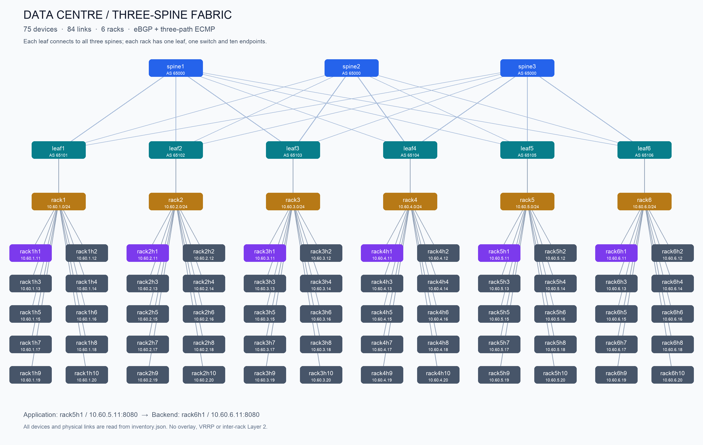

# Three-Spine Data Centre Fabric

A new standalone Kathara lab for Week 11 goal 2: **75 independent devices and 84 point-to-point links**, using eBGP and three-path ECMP between six racks. This implementation lives alongside the team's existing topologies.



[Scalable diagram](docs/topology.svg) · [Exact interface table](docs/interfaces.csv) · [Design and comparison](docs/design.md) · [Recorded validation](docs/validation.md)

## What is different

The team's enterprise labs focus on OSPF, VLANs and gateway redundancy; Abilene uses IS-IS; the multi-site benchmark combines OSPF and eBGP at ISP boundaries. Here, **every fabric hop uses eBGP**, and each leaf installs three equal-cost paths to every remote rack. Prefix filters constrain what each rack can advertise. The application in rack 5 calls a backend in rack 6 on every request, making network state observable at the application layer.

Clos/leaf-spine is an established architecture, and the repository includes a NIKA Clos reference dataset. This is a newly generated lab with its own source, addresses, route filters, services and validation; it does not claim to invent Clos or reproduce the NIKA reference. It adds routing/path diversity, with 75 devices matching the enterprise labs in scale.

| Component | Count | Role |
| --- | ---: | --- |
| `spine1`–`spine3` | 3 | FRR, AS65000 |
| `leaf1`–`leaf6` | 6 | FRR, AS65101–AS65106 |
| `rack1`–`rack6` | 6 | Independent Linux bridges |
| `rackNh1` | 6 | HTTP servers; rack5 is the application, rack6 its backend |
| `rackNh2`–`rackNh10` | 54 | Client endpoints |
| **Total** | **75** | **75 Docker containers; one shared image** |

Links: 18 leaf↔spine, 6 leaf↔rack-switch, 60 switch↔endpoint. All 84 collision domains connect exactly two devices. The software switches bridge eleven interfaces in each rack. Host traffic between racks crosses leaf→spine→leaf. There are no spine↔spine or leaf↔leaf links.

## Setup

Requirements: Docker Desktop running, Python 3.10+, and the Kathara Python SDK. The historical 39-device development run used an Apple Silicon Mac with 8 GiB assigned to Docker; resource requirements for 75 live devices have not yet been measured. Initial image build requires Internet access. No API key or model subscription is required.

```bash
cd /path/to/SOFT3888_TU14_04/DatacenterFabric
python3 -m venv .venv
source .venv/bin/activate
python -m pip install -r requirements.txt
python lab.py validate
python lab.py build
python lab.py start
```

`start` launches all 75 containers, waits 25 seconds for convergence, and runs the full baseline. If a slow machine has convergence failures, inspect startup logs before rerunning `check`. If startup is interrupted, use `status`, then `stop` before a fresh start.

This launcher uses the **Kathara Python SDK**, so a separate `kathara` executable is unnecessary. On the development Mac, the system executable failed with a macOS `pyexpat` compatibility error; the installed SDK worked. The existing local environment can be used directly:

```bash
/Users/jinjieying/Downloads/SADE-NetworkAgent/.venv/bin/python lab.py status
/Users/jinjieying/Downloads/SADE-NetworkAgent/.venv/bin/python lab.py check
python tools/record_environment.py
```

## Inspect and demonstrate

With the environment active, run:

```bash
python lab.py status
python lab.py exec leaf1 vtysh -c 'show bgp summary'
python lab.py exec leaf1 vtysh -c 'show bgp ipv4 unicast'
python lab.py exec leaf1 ip route show 10.60.6.0/24
python lab.py exec rack1h2 ping -c 3 10.60.6.11
python lab.py exec rack1h2 curl -fsS http://10.60.5.11:8080/
python lab.py exec leaf1 cat /var/log/fabric-startup.log
python lab.py check
```

Expected application response:

```text
application: healthy
rack6h1: healthy
```

The application returns HTTP 503 when its backend request fails. It is a small HTTP dependency simulator, not a production application or database. Addresses are static; names are inventory identifiers, not DNS records.

## Validate redundancy

```bash
python lab.py failover
```

This requires a passing full baseline. It disables **leaf1 eth0 only**, checks that five remote rack routes each retain **two** installed ECMP next hops, repeats all 3,540 endpoint pings and all 60 application checks, then restores the interface in `finally` and runs the full baseline again. Recovery failure makes the command fail. A forced process kill can interrupt cleanup; restore with:

```bash
python lab.py exec leaf1 ip link set eth0 up
python lab.py check
```

These are functional resilience checks; they do not measure packet loss or convergence latency during the transition.

## Stop

```bash
python lab.py stop
```

Only the named `soft3888_datacenter_fabric_v1` lab is removed. No global Docker prune or Kathara wipe is used. Host-home/shared mounts are disabled and no host ports are published. The fixed lab name allows one instance at a time; do not run this directory concurrently with a copy of itself.

## Source and evidence

- `tools/generate.py`: deterministic topology, startup scripts, FRR configs, services and inventory.
- `tools/validate.py`: offline inventory/wiring/addressing/policy/startup checks.
- `lab.py`: scoped deployment, live validation, interface inspection and recovery.
- `tools/draw_topology.py`: inventory-based SVG diagram; optionally creates PNG with Pillow.
- `tests/test_fabric.py`: regressions for miswiring, missing export policy, incorrect ECMP evidence and recovery after partial injection.
- `results/structural-validation.json`: offline evidence.
- `results/latest-health.json`: historical 39-device live baseline, including commands and raw outputs.
- `results/latest-failover.json`: historical 39-device resilience and recovery evidence.
- `results/environment.json`: historical 39-device tested versions and image identity.

```bash
python tools/generate.py
python tools/validate.py
python -m unittest discover -s tests -v
python tools/draw_topology.py
```

Regeneration changes source files only. Stop/restart the lab to apply source changes to containers. `kathara/frr:latest` and Debian repositories are mutable; the tested image identity is recorded, but a later rebuild can change packages. Goal 2 baseline validation is separate from SADE integration, fault diagnosis accuracy and model comparisons. This directory does not claim those goals are complete.
