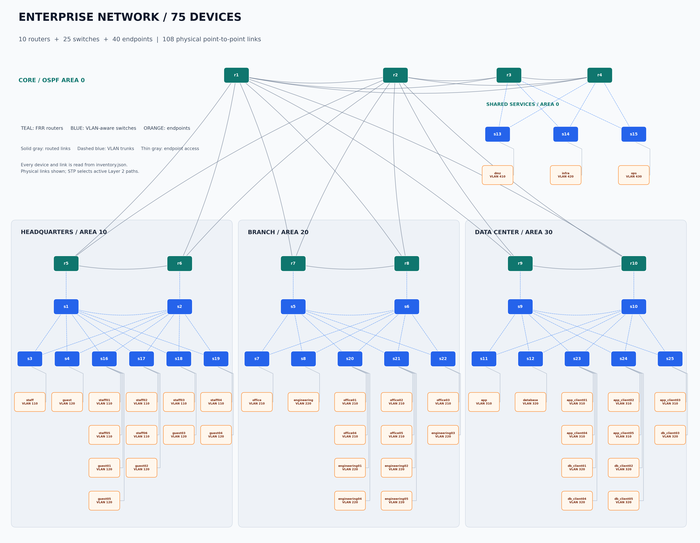

# 75-Device Enterprise Network Topology

This directory contains a standalone Kathara network lab regenerated from the 75-node implementation in the adjacent `enterprise-topology` directory. It includes **10 FRR routers, 25 independent Linux switches, and 40 endpoints: 75 devices connected by 108 point-to-point physical links**. Each device has its own container and image tag. Links and VLANs do not count as devices.

## Complete Topology Diagram

The diagram shows all 75 devices and 108 links, generated directly from `inventory.json`. Dashed blue lines represent VLAN trunks; solid gray lines represent routed connections or endpoint access. Dashed lines do not indicate standby status. STP determines the active Layer 2 forwarding paths.



[Open the scalable SVG diagram](docs/topology-75.svg). For exact ports, addresses, VLANs, and OSPF areas, see the [interface table](docs/interfaces.csv) and [device inventory](inventory.json).

## Device Inventory

| Region | Routers | Switches | Endpoints | Total devices |
|---|---|---|---|---|
| Core / Area 0 | r1, r2 | — | — | 2 |
| Shared services / Area 0 | r3, r4 | s13–s15 | dmz, infra, ops | 8 |
| Headquarters / Area 10 | r5, r6 | s1–s4, s16–s19 | staff, guest, staff01–06, guest01–05 | 23 |
| Branch / Area 20 | r7, r8 | s5–s8, s20–s22 | office, engineering, office01–05, engineering01–05 | 21 |
| Data center / Area 30 | r9, r10 | s9–s12, s23–s25 | app, database, app_client01–05, db_client01–05 | 21 |
| **Total** | **10** | **25** | **40** | **75** |

The 108 links comprise 21 router interconnections, 47 VLAN trunks, and 40 endpoint access links. Every switch runs its own VLAN-aware Linux bridge with STP enabled.

## Network and Address Design

r1 and r2 form the core. Each router from r3 through r10 connects to both core routers, and each regional router pair has a direct interconnection. Headquarters, branch, and data center fabrics use paired distribution switches and dual-homed access switches. OSPF provides inter-area routing, and VRRP provides redundant default gateways.

| Purpose | VLAN | Subnet | Default gateway |
|---|---|---|---|
| Headquarters staff | 110 | 10.10.10.0/24 | 10.10.10.1 |
| Headquarters guests | 120 | 10.10.20.0/24 | 10.10.20.1 |
| Branch office | 210 | 10.20.10.0/24 | 10.20.10.1 |
| Branch engineering | 220 | 10.20.20.0/24 | 10.20.20.1 |
| Application services | 310 | 10.30.10.0/24 | 10.30.10.1 |
| Database simulator | 320 | 10.30.20.0/24 | 10.30.20.1 |
| DMZ | 410 | 10.40.10.0/24 | 10.40.10.1 |
| DNS / DHCP | 420 | 10.40.20.0/24 | 10.40.20.1 |
| Operations | 430 | 10.40.30.0/24 | 10.40.30.1 |

Each VLAN uses `.1` as its VRRP virtual gateway, with `.2` and `.3` assigned to the physical gateway routers. Router interconnections use sequential /30 subnets within `10.255.0.0/24`. Router loopbacks range from `10.255.255.1/32` to `10.255.255.10/32`.

The four original clients, staff, guest, office, and engineering, obtain DHCP leases from the `.100–.150` pools. Other endpoints use static addresses. Service endpoints use `.10` in their respective subnets; additional clients use addresses starting at `.20`, outside the DHCP pools.

## Services and Access Policy

- `infra` (10.40.20.10) provides local DNS and DHCP; regional routers relay DHCP requests.
- `app.enterprise.test` (10.30.10.10:80) calls `database` (10.30.20.10:8080). The application returns HTTP 200 when its dependency is healthy and HTTP 503 when unavailable. The database endpoint is an HTTP simulator.
- `dmz.enterprise.test` (10.40.10.10:80) provides a DMZ HTTP service.
- Guests may access DNS and DMZ HTTP. Other guest-initiated routed traffic is rejected.
- Routed traffic to the database endpoint is restricted to application TCP/8080 and the operations subnet. Traffic within the same VLAN does not traverse the router ACLs.
- The operations endpoint can reach router loopbacks. Switches are managed through Kathara commands and have no dedicated management IP addresses.

## Build and Run

Requirements: Python 3, Docker, and Kathara. The initial image build requires Internet access. Allocate sufficient Docker memory and CPU for 75 containers. Run these commands from this directory:

```bash
python3 lab.py validate  # Parse the Kathara configuration without starting devices
python3 lab.py build     # Build the shared base and 75 device images
python3 lab.py start     # Start in batches, wait 45 seconds, then run health checks
python3 lab.py status
python3 lab.py check
```

The `enterprise-topology-75` image prefix distinguishes these images from the original lab. This lab uses the same internal IP plan inside its own Kathara networks. The launcher disables host-home and shared mounts and publishes no host ports.

Common inspection commands:

```bash
python3 lab.py exec r1 vtysh -c 'show ip ospf neighbor'
python3 lab.py exec r5 vtysh -c 'show ip route'
python3 lab.py exec s16 bridge vlan show
python3 lab.py exec s16 bridge link show
python3 lab.py exec staff01 curl -i http://app.enterprise.test/
python3 lab.py exec guest01 curl -i http://dmz.enterprise.test/
python3 lab.py stop
```

`stop` cleans up only the lab associated with this directory. Manual runtime changes are temporary. For persistent changes, update the generator or configuration, rebuild images, and restart the lab.

## Fault Experiments

Begin with a healthy baseline, inject one fault at a time, allow protocols to converge, inspect the effect, and repair the fault.

```bash
python3 lab.py fault inject core-uplink
python3 lab.py exec staff curl -i http://app.enterprise.test/
python3 lab.py fault repair core-uplink

python3 lab.py fault inject gateway-service
python3 lab.py exec r6 ip -4 addr
python3 lab.py fault repair gateway-service

python3 lab.py fault inject database-acl
python3 lab.py exec office curl -i http://app.enterprise.test/
python3 lab.py fault repair database-acl
python3 lab.py check
```

`core-uplink` disables r5 eth0 to exercise the alternate core path. `gateway-service` stops keepalived on r5 to exercise virtual gateway takeover by r6. `database-acl` blocks application access to the backend, so the application should return HTTP 503.

Run `python3 tools/verify_faults.py` for automated fault verification. The script attempts repair in `finally` blocks. After forcibly interrupting it, repair the fault manually or restart the lab.

## Files and Reproducibility

| File | Purpose |
|---|---|
| `lab.conf` | Device images, interfaces, and links for all 75 devices |
| `*.startup` | Per-device startup scripts |
| `r*/etc/` | FRR, VRRP, and DHCP relay configuration |
| `inventory.json` | Complete device and physical link inventory |
| `docs/interfaces.csv` | All 216 link interfaces |
| `docs/topology-75.png` / `.svg` | Embedded and scalable topology diagrams |
| `tools/generate.py` | Regenerate lab configuration using the Python standard library |
| `tools/draw_topology.py` | Render the inventory diagram; requires matplotlib |
| `lab.py` | Lifecycle management, health checks, and fault operations |
| `results/` | Validation results and subsequent runtime reports |

```bash
python3 tools/generate.py
python3 tools/draw_topology.py
```

See [validation notes](docs/validation.md) for this delivery's verification status. Historical runtime reports from the original lab were not copied into this directory. This standalone version has not yet been runtime-tested with all 75 containers running.
