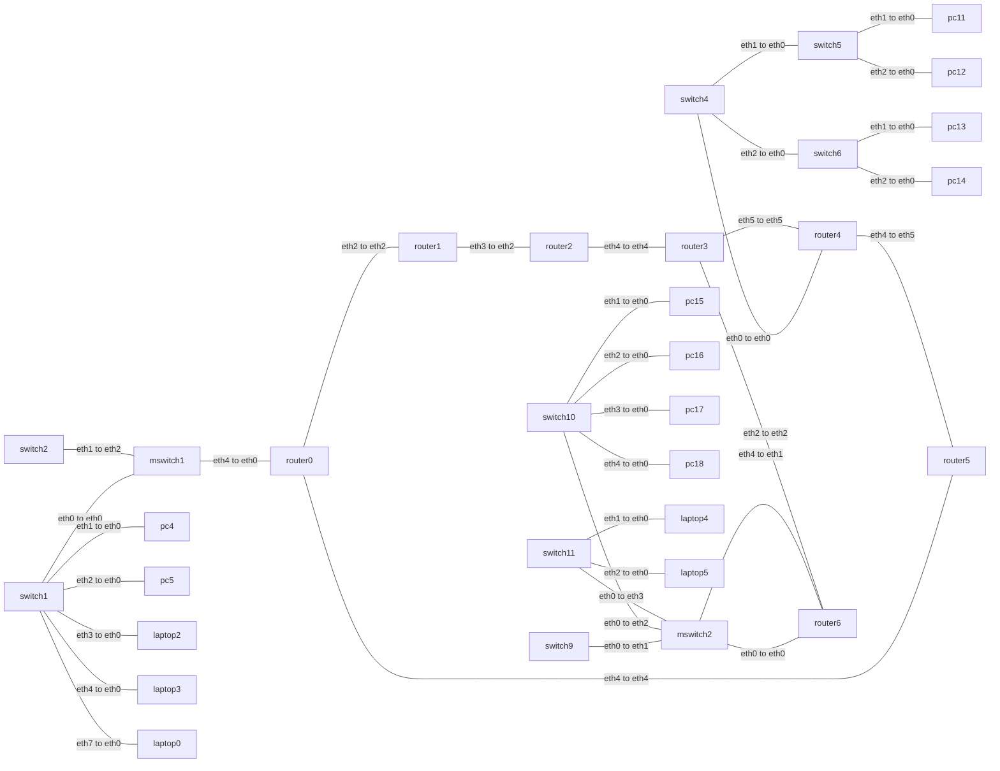

# Kath3 topology in the repository

The repository already implements a 32-device topology: 7 routers, 10 switches (including 2 multilayer switches), 10 PCs and 5 laptops. This inventory is derived from numeric interface assignments in `topology_kathara/Kath3/lab.conf`. It counts configured devices, not devices proven healthy at runtime.

The client demo uses this existing topology, rather than replacing it with the earlier standalone 12-device proposal. Existing interfaces, addressing and scenarios remain compatible.

## Connected segments

Unused one-device collision domains are omitted from the diagram. A link in lab.conf does not prove it is administratively up or forwarding.

## Demonstrated path and protocols

Laptop0 `172.16.20.10` attaches to switch1 in VLAN20. Its path to Router0 crosses switch1 and mswitch1 over the configured VLAN trunk. Router0 uses `172.16.20.1` on eth0.20 and routes to VLAN10, where PC4 is `172.16.10.4`. RIP and existing static routes connect the WAN. The remote Router2 target is `192.168.100.1`.

The wider topology includes Location C on `192.168.200.0/24` and Location B VLAN50/51 on `172.18.50.0/24` and `172.18.51.0/24`. Wireless endpoints are represented as wired devices in the original lab. The automated demo probes the nominated Laptop0/PC4/Router2 paths; it does not claim exhaustive reachability or wireless emulation.

## Configuration boundary

The demo mutates only Laptop0's running default route and the rule tagged `haosenpeng-compound-icmp`. Healthy startup files remain the source of truth. The live validator copies the complete topology to a unique temporary directory, runs the cases there, then cleans only that copy.

The historical compound-fault documentation reports an intermittent RIP startup failure. A baseline failure must abort fault injection. This update does not claim to resolve that existing startup issue.
