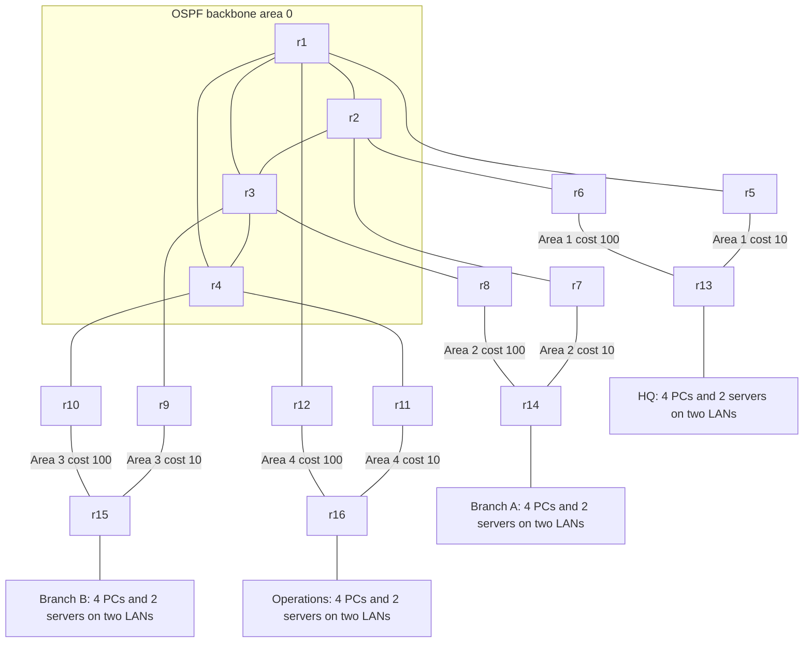

# P20Enterprise v2: redundant four-site OSPF network

P20Enterprise now contains **40 devices: 16 routers, 16 PCs and 8 server endpoints**.
It has **29 subnets**, including 21 router-to-router /30 links and eight endpoint /24 LANs.
The four-router backbone is a ring with a diagonal. Each of four sites connects through
two separate area-border routers (ABRs) to different backbone routers. OSPF area 0
connects the backbone and ABRs; sites use areas 1–4.

This is an expansion of April's own topology, not a copy of Jiayuan's Kath5 extension.
Compared with the original P20Enterprise, it adds dynamic routing, multiple areas,
redundant paths and verifiable failover. It is larger than the checked-in original
Kath5 (13 routers and two PCs), but is not claimed to be the most complex topology
in the repository. It remains below the report's longer-term 75–100-device target.

**Validation status:** see [validation/status.md](validation/status.md).
The old `20260916-all-cases-three-cycles.json` report is evidence for **v1 only**;
its nine-device static topology and four scenarios do not validate v2.
NIKA/SADE agent evaluation remains separate from network testing.

## 1. Complex network topology: implementation

| Router role | Devices | Purpose |
|---|---|---|
| Backbone | r1–r4 | OSPF area 0; ring plus r1–r3 diagonal |
| Area borders | r5–r12 | Two ABRs per site; each connects to a different core router |
| Site routing | r13–r16 | Two uplinks, a user LAN and a server LAN per site |

| Site / area | Site router | Primary / backup ABRs | PCs | Servers | User / server subnets |
|---|---|---|---|---|---|
| HQ / 1 | r13 | r5 / r6 | pc1–pc4 | server1–server2 | 10.10.1.0/24 / 10.40.1.0/24 |
| Branch A / 2 | r14 | r7 / r8 | pc5–pc8 | server3–server4 | 10.10.2.0/24 / 10.40.2.0/24 |
| Branch B / 3 | r15 | r9 / r10 | pc9–pc12 | server5–server6 | 10.10.3.0/24 / 10.40.3.0/24 |
| Operations / 4 | r16 | r11 / r12 | pc13–pc16 | server7–server8 | 10.10.4.0/24 / 10.40.4.0/24 |

Site-router eth0 is the preferred uplink (cost 10); eth1 is the backup (cost 100).
Both are active OSPF adjacencies. Eth2 connects users; eth3 connects servers.
The LANs are passive OSPF interfaces: their prefixes are advertised without
trying to form OSPF adjacencies with hosts. Router IDs are unique. No static
router routes or default routes hide withdrawal failures. Endpoint default
gateways remain static. Routers use `kathara/frr`, hosts use `kathara/base`.



The actual links are in [lab.conf](../../topology_kathara/P20Enterprise/lab.conf).
Each device has a startup file. Each router also has `etc/frr/frr.conf` containing
OSPF areas, router ID, interface costs and timers. The [addressing table](addressing.md)
and [topology.json](topology.json) describe every interface.
Server endpoints are IP targets; web/DNS applications, VLANs and BGP are not claimed.
Each site still has one site router, so this is link/ABR redundancy, not elimination
of every possible single-device failure.

## 2. Use cases: user tickets and reference diagnoses

Cases live under [dataset/p20enterprise_Q/custom](../../dataset/p20enterprise_Q/custom/).
Every file declares `Topology: P20Enterprise`. The manifest selects only v2 cases.

| CLI case | User situation | Correct diagnosis |
|---|---|---|
| `healthy` | Reported widespread outage | Measured network is healthy; no repair needed |
| `failover` | HQ primary-link alarm, connectivity still works | R13 eth0 is down; traffic converged via eth1/R6; redundancy degraded |
| `isolation` | HQ cannot reach other sites; local traffic works | Both HQ uplinks are down |
| `advertisement` | Remote sites cannot reach HQ servers; HQ PCs can | HQ server /24 withdrawn from OSPF; physical link remains up |
| `server-link` | Local and remote PCs cannot reach HQ servers | HQ server-facing interface is down; server-to-server same-LAN traffic works |
| `gateway` | Only PC1 loses off-LAN connectivity | Wrong default gateway on PC1 |

`[PROMPT-TO-AGENT]` describes the symptoms. `[GROUND-TRUTH]`, `[FIX]` and
`[SCORING-AXES]` are evaluator material. Failover is a real component failure
with restored service, distinct from the healthy false-premise control.

## 3. Test cases: network correctness before agent evaluation

[validate_p20_enterprise.py](../../tools/validate_p20_enterprise.py) creates a unique
temporary lab, checks all 40 devices' addresses/forwarding/gateways, and verifies:

- 29 connectivity probes covering every endpoint, including local controls.
- Full-neighbor counts on all 16 OSPF routers.
- R13 uplink and server-interface state.
- The actual OSPF next hop for a remote user LAN: primary before the fault,
  backup during failover, primary after repair.
- HQ server advertisement configuration, local connected route and remote OSPF route.
- PC1's gateway, repeated injection, exact repairs and recovery.

Each stage requires two consecutive matching check rounds. Expected ping failure
requires both measured loss and ping exit status 1; missing commands and tool errors
cannot pass as faults. Checks are batched with independent exit codes and bounded
concurrency. A timeout fails the report; a failed cleanup also makes the run fail.
Only the unique lab created by that invocation is cleaned.
By default, checks execute with `docker exec` after verifying the exact lab hash,
owner and complete device inventory using Kathara metadata. Kathara still handles
deployment and cleanup. `--exec-backend kathara` retains the CLI execution path.
Activate the Kathara Python environment for the default backend.

OSPF convergence may briefly interrupt traffic. The test proves stable backup
forwarding after convergence, not zero-loss failover or a convergence-time SLA.
The 120-second polling budget is checked between rounds; an in-flight round and
bounded commands may extend wall-clock duration beyond it.

[test_validate_p20_enterprise.py](../../tools/test_validate_p20_enterprise.py) checks
address uniqueness, subnet overlap, compatible transit peer settings, ABR structure,
alternate physical paths after every single transit-link cut, fault distinctions,
route-output parsing and safe validator control flow. Its graph model is not an
OSPF simulation; the live suite is the evidence for actual FRR operation.

## 4. Configuration changes: inject and repair

These are commands **inside the named device**, not commands to run on macOS.
The validator executes them for you. Startup files and checked-in FRR configuration
retain the healthy baseline. No `write memory` command persists the injected fault.

| Case | Device | Injection | Repair |
|---|---|---|---|
| Failover | r13 | `ip link set eth0 down` | `ip link set eth0 up` |
| Isolation | r13 | Set both eth0 and eth1 down | Set both eth0 and eth1 up |
| Advertisement | r13 | In `router ospf`: `no network 10.40.1.0/24 area 0.0.0.1` | Add `network 10.40.1.0/24 area 0.0.0.1` |
| Server link | r13 | `ip link set eth3 down` | `ip link set eth3 up` |
| Gateway | pc1 | `ip route replace default via 10.10.1.254` | `ip route replace default via 10.10.1.1` |

The old `return-route` CLI case was retired: routers now learn remote routes via
OSPF, so deleting a learned kernel route is not a durable static-route fault.
Use `advertisement` to demonstrate a genuine control-plane configuration problem.
The old four scenario IDs are retired; their definitions remain in Git history
at commit `9d4a351`. V2 uses explicit `p20-enterprise-v2-...` IDs.

## 5. NIKA reference and SADE role

[NIKA](https://github.com/sands-lab/nika) is a network-troubleshooting benchmark
and orchestration framework. Its separation of environment, incident, tools and
evaluation informs these cases. This project stores them in its own FaulT-Bench
scenario format; adding a NIKA label does not make a native NIKA adapter.

The existing FaulT-Bench pipeline connects the external SADE-NetworkAgent package's
NIKA/Kathara tools to agents. SADE supplies a diagnosis workflow, skills and helpers.
The current SADE prompt asks it to diagnose and propose a fix, not automatically repair.
FaulT-Bench compares its answer with evaluator ground truth. Our deterministic
validator knows the injected cause in advance and does not measure agent reasoning.
No LLM calls, API keys or completed SADE/NIKA integration are implied by live PASS.
Keep ground truth and injection files unavailable to the evaluated agent.

Relevant existing files: `faultbench/src/faultbench/lab.py`, `orchestrator.py`,
`runners/sade.py` and `prompts/sade_freetext.py`.
The [manifest](../../faultbench/benchmarks/p20-enterprise.csv) is a handoff to that
pipeline, not proof of a successful agent run. Pin and validate the team's NIKA/SADE
version before making integration claims.

References: [NIKA task creation](https://github.com/sands-lab/nika/blob/main/docs/creating-benchmark-tasks.md),
[FRR OSPF configuration](https://docs.frrouting.org/en/latest/ospfd.html).

## Run and maintain

From `FaulT-Bench/`, with Docker running and Kathara on PATH:

```sh
python tools/validate_p20_enterprise.py --check-only
python -m unittest discover -s tools -p 'test_validate*.py' -v
python tools/validate_p20_enterprise.py --case failover
python tools/validate_p20_enterprise.py --case advertisement
python tools/validate_p20_enterprise.py --repeat 3
```

Both `kathara/base` and `kathara/frr` images must be installed. Pull missing images
before starting a demo. This topology starts 40 containers and consumes more resources
than v1. A three-cycle run repeats cases within one deployment; a second invocation
tests a separate fresh deployment. Reports go to `faultbench/runs/p20-enterprise/`
and include version, configuration/scenario hashes, image digests, observations and cleanup.

The source model is [p20_enterprise_model.py](../../tools/p20_enterprise_model.py).
It generates the topology, addressing inventory and scenarios together to prevent drift:

```sh
python tools/build_p20_enterprise.py --check
# After an intentional edit to the source model:
python tools/build_p20_enterprise.py
```

For the demo, show the topology, the preferred route, a primary-link failure and
the changed next hop while traffic continues. Contrast that with both uplinks down
or a missing advertisement. Show exact repairs and the saved validation evidence.
