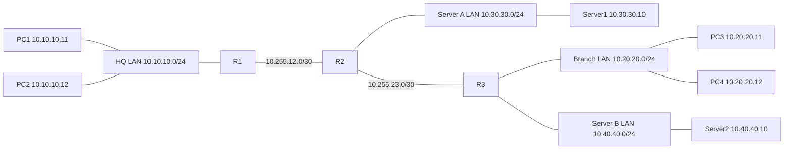

# P20Enterprise custom network topology

This is a newly implemented project topology, separate from the imported Kath3 environment and Sarah's branch. It extends the simple client–router–client pattern into a headquarters site, branch site and two server subnets connected by three routers. It includes actual Kathara link definitions, addressing, startup configuration, forward and return static routes, fault cases and an isolated validator.

The design is similar in approach to Sarah's subnet/router expansion, but was independently created for this branch. Sarah's work and existing scenarios are unchanged. This is a nine-device intermediate milestone, not the report's longer-term 75–100-device target. It uses static IPv4 routing; VLANs, dynamic routing and redundant paths are outside this topology's current scope.

**Validation status:** 27 offline tests pass. All four cases passed three live cycles on 16 September 2026: 92 check rounds passed, final configuration verification succeeded, and cleanup returned zero. The [saved live report](validation/20260916-all-cases-three-cycles.json) records Kathara 3.8.3, Docker 28.4.0 and the image digest. This establishes the tested connectivity and fault/recovery behavior on this host; NIKA/SADE evaluation remains pending.

## 1 Complex network topology

Nine devices: three routers, four PCs and two server endpoints. Six subnets: four endpoint LANs and two transit networks. Kathara collision domains provide the shared LANs, so no separate switch containers are counted. Server endpoints are IP reachability targets; no HTTP or DNS service is claimed.



PC1 to Server2 crosses R1, R2 and R3. R3 needs a route back to HQ. Server1 and Server2 use different attachment points, allowing a server-specific failure to be distinguished from an entire-site or host-gateway failure.

The source is `topology_kathara/P20Enterprise/lab.conf` and nine `*.startup` files. [topology.json](topology.json) records every interface address, collision domain and static route, and offline tests compare it with the generated configuration. [Addressing](addressing.md) gives the human-readable interface table. All addresses use private IPv4 ranges. `10.10.10.254` is reserved as the unused wrong gateway.

## 2 Use cases

| ID | Goal | Flow and acceptance criterion |
|---|---|---|
| UC01 | Deploy a custom multi-subnet environment | Start all nine devices, verify startup completion, addresses, routes and forwarding settings; all eight baseline probes pass twice consecutively. |
| UC02 | Diagnose a server-network outage | Shut down R2's server-facing eth2; Server1 paths fail while branch and Server2 controls work. |
| UC03 | Diagnose missing return routing | Remove R3's route to HQ; HQ cannot complete exchanges with the branch/Server2 while other paths work. Explain why forward reachability alone is insufficient. |
| UC04 | Diagnose an individual client issue | Change PC1's gateway; local PC2 stays reachable while PC1's off-subnet probes fail. Other clients still work. |
| UC05 | Restore and repeat | Repair the changed setting, verify the full baseline and repeat each case from a healthy state. |
| UC06 | Reject an inaccurate report | Use a false-premise ticket on the healthy topology; measured network checks contradict the claimed outage. Agent diagnosis evaluation remains pending. |

## 3 Test cases

The validator checks eight paths, including local LAN, cross-site and cross-server traffic. It also checks the exact route, gateway and interface state. Negative ping checks require a measured loss percentage and the expected exit status. Missing tools or execution output cannot count as an expected failure.

| Probe | Healthy | R2 server interface down | R3 HQ return route missing | PC1 wrong gateway |
|---|---|---|---|---|
| PC1 → PC2 | works | works | works | works |
| PC1 → PC3 | works | works | fails | fails |
| PC1 → Server1 | works | fails | works | fails |
| PC1 → Server2 | works | works | fails | fails |
| PC3 → Server1 | works | fails | works | works |
| PC3 → Server2 | works | works | works | works |
| PC3 → PC4 | works | works | works | works |
| Server1 → Server2 | works | fails | works | works |

TC01 verifies configuration and healthy paths. TC02–TC04 exercise the three faults above. TC05 repeats injection to check idempotence. TC06 restores and rechecks the baseline. TC07 repeats the complete suite three times. TC08 performs a separate fresh invocation to check clean deployment reproducibility. TC09 uses the healthy false-premise control. TC01–TC07 and TC09 now have live evidence in the saved three-cycle report. A separate successful return-route-only run preceded it. TC08, repeating the entire suite from another fresh deployment, remains a separate check.

Offline tests verify address uniqueness, six nonoverlapping subnets, configuration/spec consistency, routing in both directions for all 30 ordered pairs of distinct endpoints, each fault's predicted impact, and failure/repair control flow. This model does not simulate ARP, Linux implementation details, container capabilities or performance.

## 4 Configuration changes

These commands run inside the named lab device, never on the host. The automated validator applies them only to a unique temporary lab.

| Case | Node | Injection | Repair |
|---|---|---|---|
| Server link | r2 | `ip link set eth2 down` | `ip link set eth2 up` |
| Missing return route | r3 | `ip route del 10.10.10.0/24 via 10.255.23.1` | `ip route replace 10.10.10.0/24 via 10.255.23.1` |
| Wrong gateway | pc1 | `ip route replace default via 10.10.10.254` | `ip route replace default via 10.10.10.1` |

The native route-deletion scenario additionally tolerates reinjection once the route is already absent. Every case starts from verified healthy configuration. Cases run independently; combining faults is not necessary to demonstrate this topology.

The server-link example is the closest to Sarah's work. The missing-return-route example shows a distinct consequence of the added third router and remote branch. Use either as the main demonstration after live rehearsal.

## 5 NIKA as a reference

Following the scenario/problem/evaluation separation in the official [NIKA task guide](https://github.com/sands-lab/nika/blob/main/docs/creating-benchmark-tasks.md), this topology has separate network configuration, user reports, deterministic injections, verification checks, ground truth and repairs. The native files are in `dataset/p20enterprise_Q/custom/` and the manifest is `faultbench/benchmarks/p20-enterprise.csv`.

Each scenario declares `Topology: P20Enterprise`, matching the existing loader's `topology_kathara/P20Enterprise/` path. Check expectations use the supported numeric and packet-loss forms, not unrecognised `success`/`failure` labels. Project cases are outside the published dataset layers. No version-specific NIKA fault-label mapping is asserted.

The isolated validator uses the existing strict CLI execution wrapper and does not run an agent. The repo's agent pipeline uses its Python API lab registration and external SADE/NIKA environment. Ground truth stays evaluator-facing. The new manifest is a handoff artifact, not proof of successful NIKA/SADE execution.

## Run the demo

From `FaulT-Bench/`, run offline checks first:

```sh
python3 tools/validate_p20_enterprise.py --check-only
python3 -m unittest discover -s tools -p 'test_validate*.py' -v
```

With Docker running and Kathara installed, pull the image if needed and run one case:

```sh
docker pull kathara/base
python3 tools/validate_p20_enterprise.py --case server-link
```

Run all cases and recovery three times:

```sh
python3 tools/validate_p20_enterprise.py --repeat 3
```

This creates an isolated temporary copy, verifies all nine device configurations, records baseline/fault/recovery states, and cleans only its own lab. Evidence goes to a unique JSON file in `faultbench/runs/p20-enterprise/`. The report records config/scenario hashes, image digest, commands and outputs, iteration IDs, errors and cleanup. Initial Docker/Kathara failures are saved as failed runs, never successes. If cleanup fails, use `kathara lclean -d` with the exact temporary directory recorded in the report.

Startup files retain the healthy baseline. If a process is killed abruptly, clean that specific temporary lab and rerun. The default convergence polling budget is 90 seconds, with per-command timeouts; the final check round can extend elapsed wall-clock time past the polling budget. Two matching rounds are required, and healthy ping checks require zero packet loss. Repetition within one launch is distinct from repeated fresh deployment.

After the external agent setup is ready, preview its plan from `faultbench/`:

```sh
./fb.sh bench --manifest benchmarks/p20-enterprise.csv --agents cc-baseline --dry-run
```

The existing agent pipeline has separate lifecycle/checking behavior. Its successful dry-run is only a plan check. Run and review the strict live validator before attempting agent evaluation, and retain actual traces before claiming integration.

## Client presentation

Explain the added sites/subnets and three-hop path, state the selected user case, show a healthy baseline, inject one fault, compare affected and unaffected paths, show the precise repair and recovery, then present repeatability evidence and request client feedback. All team members can speak about different parts of this single example. Attribute Sarah's separate work accurately; this new topology is not a merge or copy of her branch.
