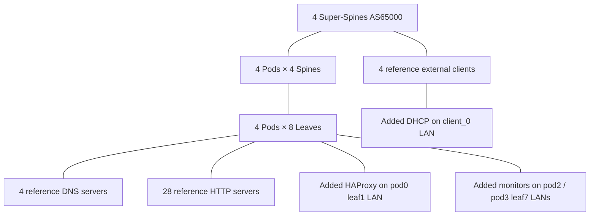

> Reproduction tools, evaluator-only Ground Truth catalog and raw evidence
> are now included. Follow [the runbook](../../docs/soft3888-runbook.md).
> Docker images are locally built from the supplied recipes. Model inference
> and judge scoring require separately configured credentials.

# Topology 2: NIKA Clos extension — 92 devices

This replaces the undersized 41-device prototype as the second SOFT3888
deliverable. It is an **export and extension of an existing NIKA reference**,
not an independently invented Clos. The required range is 75–100 devices.

## Exact source and retained structure

Source: the repository's pinned SADE dependency, commit
`aa8488a09ddb3a57e08f8137afd04bc87886e734`, file
[`src/nika/net_env/data_center_routing/dc_clos_bgp/lab_services.py`](https://github.com/Overlxrd-uwu/SADE-NetworkAgent/blob/aa8488a09ddb3a57e08f8137afd04bc87886e734/src/nika/net_env/data_center_routing/dc_clos_bgp/lab_services.py),
constructor **`DCClosService(topo_size='l')`**. This is the vendored NIKA
reference in the existing project; it is not represented as current upstream
NIKA's native API.

`tools/extend_nika_clos.py` actually invokes this constructor without deploying
it, exports its interface graph and extracts addresses, ASNs, router IDs,
advertised prefixes and peer pairs. It preserves all 88 source devices and
228 source collision domains. `reference-provenance.json` records the source
commit/hash, original graph, added graph and generated-reference file hashes.
Regression tests independently instantiate the source and compare its graph,
router addresses, peer ASes and advertised networks against this export.

| Component | Original NIKA large | Extension | Final |
|---|---:|---:|---:|
| Super-Spine routers | 4 | 0 | 4 |
| Spine routers | 16 | 0 | 16 |
| Leaf routers | 32 | 0 | 32 |
| DNS servers | 4 | 0 | 4 |
| HTTP servers | 28 | 0 | 28 |
| External clients | 4 | 0 | 4 |
| DHCP server | 0 | 1 | 1 |
| HTTP load balancer | 0 | 1 | 1 |
| Management monitors | 0 | 2 | 2 |
| **Total devices** | **88** | **4** | **92** |
| **Collision domains** | **228** | **0** | **228** |



All Super-Spines connect to all 16 Spines. Within each pod every Spine
connects to all eight Leaves. Source /31 fabric links remain in 172.16.0.0/16;
service LANs remain `10.<pod>.<leaf>.0/24`, gateways `.1`, service hosts `.2`.
External LANs remain `192.168.<pod>.0/24`. The four new nodes join existing
LANs, so no reference link or interface is removed or renumbered.

## Explicit runtime adaptations

- Use the already verified FRR/host images and shared read-only `/usr` runtime
  on Docker vfs. Remove source stress-image CPU/memory limits for this lab.
- Preserve ASN/router-ID/neighbor/network values, with current FRR IPv4
  address-family syntax, explicit interface-up commands, bounded config replay
  and faster convergence timers. No topology or AS-plan substitution.
- Replace the source's `systemctl start named` with the existing dnsmasq
  controller, suitable for the current container images. Preserve all
  `web0.pod0` … `web6.pod3` records; replicate records across the four reference
  DNS hosts so alternate resolvers answer every pod deterministically.
- Keep the source's Python HTTP80 service and add identifiable page content.
- Add dhcp1 at 192.168.0.67. `client_0` keeps its source address 192.168.0.2
  through an actual reserved DHCP lease; its source gateway is still .1.
- Add lb1 at 10.0.1.80:8080 forwarding to the original first three pod0 web
  servers. `/stats` on port9090 permits only the two monitor LANs.
- Add monitor1 at 10.2.7.200 and monitor2 at 10.3.7.200 with DNS/HTTP probes.

## Four benchmark cases

| Case | Exact location | Root cause and controls |
|---|---|---|
| BGP AS mismatch | leaf_router_0_1 | Four remote ASes set to 65999 instead of 65100–65103; local LAN and pod2 HTTP remain healthy |
| Prefix filtering | leaf_router_1_1 | Outbound filter denies 10.1.1.0/24 on all four peers; sessions stay up, DNS and another pod work |
| DHCP wrong gateway | dhcp1 / renewed client_0 | Server advertises .254 instead of 192.168.0.1; real renewed lease gets wrong default; client_1 works |
| Backend ports | lb1 | All three backend ports changed from 80 to 81; frontend503, direct backend200 and DNS healthy |

A separate optional compound recipe (`faultbench/experiments/nika92_compound.json`)
combines a wrong default gateway and frontend-specific firewall DROP on
client_1; it checks both partial repair orders and is excluded from the core
four-case manifest. Consult its own evidence before claiming validation.

Cases and Ground Truth: `dataset/nika92_Q/custom/` from repository root.
Manifest: `faultbench/benchmarks/nika92.csv`. Every case has strict baseline,
fault-state, recovery checks, user ticket, canonical fix and scoring criteria.
See [TEST_CASE.md](TEST_CASE.md) and [USE_CASE.md](USE_CASE.md).

## Run and inspect actual evidence

```sh
source /workspace/venvs/faultbench/bin/activate
python tools/extend_nika_clos.py
python tools/configure_nika92_benchmark.py
python -m unittest discover -s tools -p 'test_nika92_reference.py'
python tools/validate_soft3888.py NIKA_Clos_Jiayuan_92Devices --repeats 2
python -m faultbench bench --manifest faultbench/benchmarks/nika92.csv --agents sade --dry-run
```

Generators refuse to overwrite divergent files. The validator checks the
actual device/link counts, all 52 routers' BGP peer counts, all 28 reference
web services remotely, four DNS endpoints, DHCP, HAProxy and management
access. Each core fault is injected twice and repaired; the complete 99-check
baseline is repeated after each repair. A single reference Leaf uplink is
also disabled/recovered. Real MCP tools exercise the explicit role inventory.

Read [executed results](../../docs/soft3888-validation-results.md) for the
current actual outcome. The 41-device prototype's historical reports do not
validate this topology. Live reports record raw output, exit codes, hashes and
cleanup; specification text alone is never a pass. Model inference/scoring
remains dependent on secure API credentials.

## Retained reference reachability boundary

The four external clients are service consumers; the source is not a fully
connected external WAN. All four Super-Spines use the source AS65000. A
Super-Spine does not learn another Super-Spine's external-client prefix back
through a Spine because of AS-loop prevention. For example, client_1 cannot
ping client_0 even while client_1 successfully opens the application. This
behavior is preserved and is not one of the four injected faults. Raw ping,
missing route and successful HTTP evidence is in
[nika92-reference-external-routing-diagnosis.json](../../docs/validation/soft3888/nika92-reference-external-routing-diagnosis.json).

The healthy-state MCP sample targets client_0/client_1, so some sampled paths
are correctly down. Upstream ping parsing initially reported seven paths as
unknown because `+2 errors` occurs before `100% packet loss`. The local
adapter handles this syntax using real packet statistics; execution errors
and timeouts still remain unknown. The later supplemental experiment checks
the updated MCP tools on a fresh lab. Earlier core reports retain the exact
old harness hash and raw unknowns; their 99 healthy assertions and four fault
state/recovery tests do not depend on treating unknown probes as successes.


## Executed acceptance for this revision

- Two fresh core cycles passed all four faults, repeated injection, recovery,
  the complete99-check baseline after every repair, and redundant-link
  failover/recovery. Exact-lab cleanup passed for both.
- One additional fresh compound cycle passed both partial repair orders,
  complete recovery, the full baseline and cleanup. Its MCP sample returned
  71 ok /7 down /0 unknown, matching the inherited reference boundary.
- 34 regression tests passed, including direct reference construction and
  real ICMP error-output parsing. Both manifests passed SADE dry-run.

Core evidence: [cycle1](../../docs/validation/soft3888/NIKA_Clos_Jiayuan_92Devices-cycle1-soft3888-334b26835113.json),
[cycle2](../../docs/validation/soft3888/NIKA_Clos_Jiayuan_92Devices-cycle2-soft3888-d44d6583784d.json).
Supplement: [compound and updated MCP](../../docs/validation/soft3888/NIKA_Clos_Jiayuan_92Devices-cycle1-soft3888-b5401538db83.json).
These describe the recorded hashes; future configuration edits require their
own validation. No model inference or score is included.
