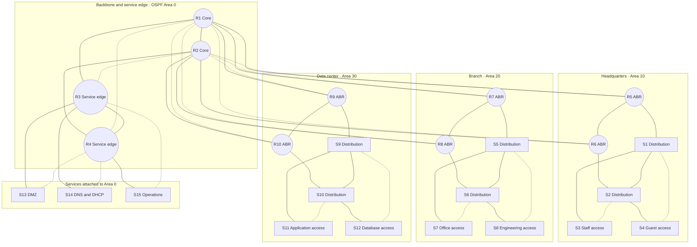

# Independent topology proposal v1: Multi-area enterprise network

Status: Implemented as a standalone Kathara lab. See README.md for commands and results/latest-health.json for the latest runtime evidence.

Scope: 10 routers and 15 separate Layer 2 switch nodes. Clients and servers are additional nodes. Shared links or collision domains do not count as switches.

This is an independent design, not a copy of the customer's local labs. NIKA's enterprise OSPF scenarios and fault verification workflow are references; this design is not a built-in NIKA scenario and API compatibility has not been validated.

References:
- https://github.com/sands-lab/nika
- https://github.com/sands-lab/nika/blob/main/docs/creating-benchmark-tasks.md

## Infrastructure topology (endpoints omitted)

Solid and dotted edges both represent physical links. Dotted edges highlight additional redundancy, not a guaranteed standby state. OSPF costs select routed paths; STP selects forwarding paths in the Layer 2 domains.

## Device roles and protocols

- R1/R2 are backbone routers. R3/R4 connect the shared services. Their interconnections and the uplinks to R5-R10 belong to OSPF Area 0.
- R5/R6 are Area 10 border routers for headquarters; R7/R8 serve Area 20 for the branch; R9/R10 serve Area 30 for the data center. Each pair's direct interconnection and local VLAN interfaces belong to its local area. Every area connects directly to Area 0.
- S1/S2, S5/S6, and S9/S10 are Layer 2 distribution pairs. S3/S4, S7/S8, and S11/S12 provide endpoint access. Inter-switch links are VLAN trunks.
- Use STP to prevent loops on the distribution interconnect and dual access uplinks. Assign deterministic primary and secondary root priorities in each region. Do not use cross-device link aggregation in v1.
- Each router pair provides VLAN gateways through subinterfaces and VRRP. User and server VLAN interfaces are passive in OSPF; routing adjacencies form on router interconnections.
- R3/R4 both connect to S13, S14, and S15 and provide redundant gateways for their service subnets. S13 serves the DMZ, S14 DNS/DHCP, and S15 in-band operations. This is not an isolated out-of-band management network.
- The initial lab is closed: no real Internet connection, external AS, BGP, or NAT is assumed. Any later external routers must be counted separately.

## Address plan

Use sequential /30 subnets from 10.255.0.0/24 for routed interconnections. Router loopbacks are 10.255.255.1/32 through 10.255.255.10/32.

| Segment | VLAN | Subnet | Virtual gateway |
|---|---|---|---|
| Headquarters staff | 110 | 10.10.10.0/24 | 10.10.10.1 |
| Headquarters guests | 120 | 10.10.20.0/24 | 10.10.20.1 |
| Branch office | 210 | 10.20.10.0/24 | 10.20.10.1 |
| Branch engineering | 220 | 10.20.20.0/24 | 10.20.20.1 |
| Data center applications | 310 | 10.30.10.0/24 | 10.30.10.1 |
| Data center databases | 320 | 10.30.20.0/24 | 10.30.20.1 |
| DMZ | 410 | 10.40.10.0/24 | 10.40.10.1 |
| DNS/DHCP | 420 | 10.40.20.0/24 | 10.40.20.1 |
| Operations | 430 | 10.40.30.0/24 | 10.40.30.1 |

Use .2 and .3 for the actual gateway router addresses. Place at least one test endpoint or service on every access/service switch. User VLANs use DHCP relay; servers use static addresses. Exact ports and interface names are recorded in interfaces.csv and ../inventory.json. All six regional routers have separate links to both core routers.

## Intended traffic policy

Office and engineering clients may query DNS and reach applications and the DMZ. Applications may reach the designated database service port. Guests may reach DNS and the DMZ, but internal applications and databases are denied. Operations may reach device management addresses. Exact allowed ports must be fixed during implementation. DMZ separation requires explicit ACLs; the label alone provides no isolation.

## Candidate fault experiments

1. Core uplink failure: verify convergence through an alternate path; distinguish transient loss from persistent failure.
2. OSPF area mismatch on a regional router interconnection: verify the affected adjacency and whether redundancy masks the service impact.
3. Missing VLAN on an access trunk: verify affected clients and unaffected VLANs; account for the alternate uplink.
4. Active gateway failure: verify VRRP takeover and service recovery.
5. Incorrect DHCP relay destination: verify using a new lease request, not an existing lease.
6. Incorrect DNS record: compare name-based access with direct IP access.
7. Incorrect application-to-database ACL: verify the actual TCP service, not ping alone.
8. Static blackhole route: verify the target prefix and an unaffected control prefix.
9. Healthy-network false report: identify expected policy denials without injecting a fault.
10. Misidentified device in a ticket: use network evidence to locate the actual fault.

Each experiment needs a healthy baseline, injection command, post-injection check, expected impact, repair command, and recovery check. These are proposed experiments, not implemented tests.

## Storage and execution

The deployable topology is stored in ../lab.conf, with one startup script per device and configuration directories for routers and services. ../inventory.json and interfaces.csv provide the full 34-node, 57-link inventory. This Markdown diagram is documentation only; Kathara consumes lab.conf.

Use ../lab.py for build, start, check, status, exec, fault, and stop operations. See ../README.md for exact commands. The lab uses FRR for OSPF, keepalived for VRRP, Linux VLAN-aware bridges with STP for switching, and dnsmasq for DNS/DHCP and relaying.

The database endpoint is a lightweight HTTP dependency simulator on port 8080, not a database engine. The application makes a real HTTP request to it and returns 503 when that dependency is unavailable. No NIKA adapter or LLM agent evaluation is included.

Three faults have executable injection and repair commands: core-uplink, gateway-service, and database-acl. The remaining candidate experiments above are future work. Runtime reports distinguish implemented features from observed verification results.
